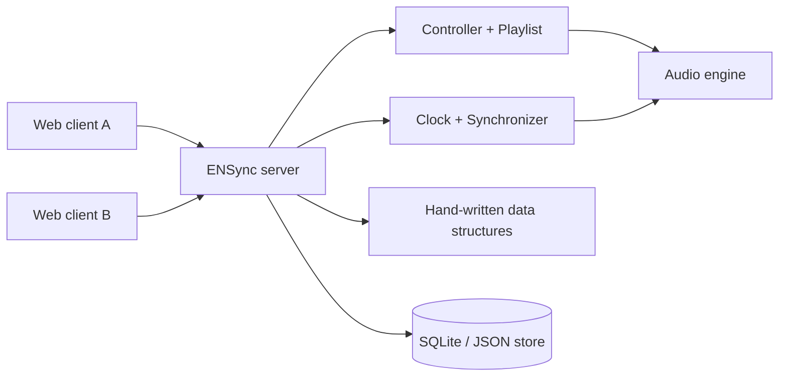

# Architecture

## Components

## Module map

| Layer | Directory | Responsibility |
| --- | --- | --- |
| Common | `include/common`, `src/...` | Shared types, constants and errors (planned) |
| Controller | `include/controller`, `src/controller` | Rooms, playlists, commands |
| Client | `include/client`, `src/client` | Connected client state, roles, succession |
| Network | `include/network`, `src/network` | Server, sockets, wire protocol |
| Audio | `include/audio`, `src/audio` | Playback scheduling and sample buffers |
| Sync | `include/sync`, `src/sync` | Monotonic clock, offset estimation, drift correction |
| DSA | `include/dsa`, `src/dsa` | Queue, circular buffer, min-heap, linked list, hash table |

## Design notes

- The Ensync Clock is monotonic and ignores the device system clock.
- All timed actions go through the min-heap scheduler.
- Live state stays in memory; durable data is loaded from storage at startup.

*TODO: add class/sequence diagrams and detailed data flow.*
